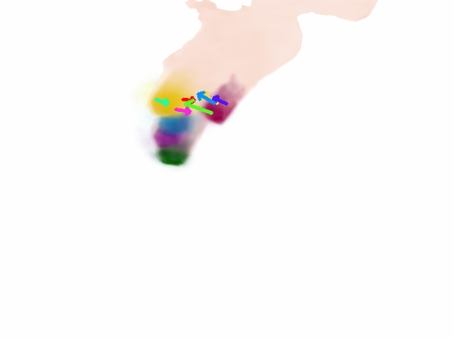
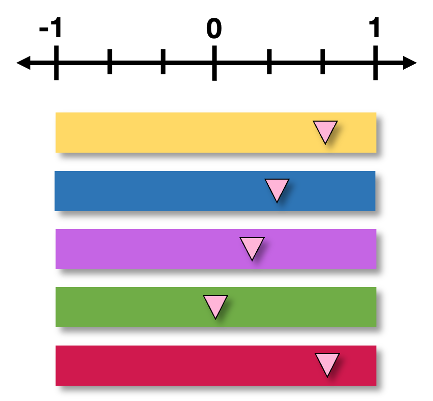

<link rel="stylesheet" href="{{ '/assets/css/posts/embodied-programming.css' | relative_url | bust_file_cache }}">

Today I gave a talk at Brown's Carney Institute for Brain Science called _Embodied Programming Through Vision_. Thank you to everyone who came, and to Carney for hosting me. This post is a written version of the talk.

# TL;DR

Robots can learn how their own bodies move from vision alone, by watching themselves execute random commands. A video model can plan what should happen in the world, and a learned body program turns that plan into commands for one particular robot. The planner never needs to know any robot's action coordinates. That is why I think embodiment generalization need not be a distinct learning problem.

Prologue
{: .ep-act}

# Is this a robot?

Put a few motors on a desk lamp and you get a machine you can command. Is it a robot? My intuition is that it counts if we can control it to do different things. (I wrote more about this question in [an earlier post](/blog/2025/jacobian-fields-tutorial/).)

An ordinary IKEA desk lamp.|<a href="https://hackaday.io/project/19235-tertiarm-3d-printed-robot-arm">Tertiarm</a>, a hobbyist's robot arm built from an IKEA lamp. Would you call it a robot?
{::nomarkdown}

{:/nomarkdown}

The question keeps coming up because robots no longer look like the rigid systems in textbooks. New manufacturing techniques enable new kinds of robots. The hand below has tendons and pressure-sensing fingertips, combines soft and rigid materials in one structure, and is 3D printed in one go by a single machine.

{::nomarkdown}

{:/nomarkdown}

The pneumatic hand we worked with is also printed directly, from several materials and without assembly. It costs about 300 dollars to print<d-cite key="matusik2024pneumatic"></d-cite>, and once it is printed, we can mount it on a robot arm.

{::nomarkdown}

{:/nomarkdown}

There was just one problem: we had no good way to control it. Controlling a robot means that, given a desired motion in space, such as pinching the index finger and the thumb, we find the commands that produce it. For this hand, that is how much air pressure to put in each tube.

The 3D-printed pneumatic hand, mounted on a robot arm.|A desired motion in space: pinch the index finger and the thumb (the arrows).|The commands that produce it: how much air pressure goes into each tube.
{::nomarkdown}

{:/nomarkdown}

Conventional robots avoid this problem by design. A Shadow Hand costs 150,000 to 200,000 dollars, and a UR5 arm over 30,000. They are expensive because conventional control needs precise sensors and motors in every joint, and very precise manufacturing. The controller infers the robot's configuration from those joint sensors alone. It is like closing your eyes and guessing where your body is from muscle signals.

A Shadow Hand and a UR5 arm, next to the printed hand.|Inside a UR5 joint: a precise motor and sensor.|Rigid links, with a sensor at every joint (A to F).
{::nomarkdown}

{:/nomarkdown}

People, in contrast, are capable embodied programmers. We can learn to teleoperate a new robot within minutes, and the only sensors we need are our eyes. From vision alone, we build a model of the robot and predict how our commands will move it.

{::nomarkdown}

{:/nomarkdown}

Act I
{: .ep-act}

# Learning a body from vision

How have people tried to give robots this ability? Physics-based models need an expert to write down the geometry, the material properties, and simplifying assumptions, such as a backbone with constant curvature<d-cite key="dellasantina2023softcontrol"></d-cite>. Sensors and markers need the body to be instrumented, with sensors built into it or markers tracked by motion capture<d-cite key="truby2020proprioception"></d-cite>. Visual self-models learn the robot's shape from cameras, but they take measured joint angles as input, so they still assume precise encoders<d-cite key="chen2022selfmodel"></d-cite>. The printed hand has no joint sensors, and its soft materials are hard to model by hand. We wanted something that needs vision alone.

{::nomarkdown}

{:/nomarkdown}

Neural Jacobian Fields<d-cite key="li2025njf"></d-cite> need only vision: one image in, 3D motion out. From a single camera image, a network predicts a Jacobian field. For every 3D point, the field is a linear map from a small change in the command to the motion of that point:

$$
\delta \mathbf{x} = \mathbf{J}(\mathbf{x}, I)\,\delta \mathbf{u}.
$$

The input is a single camera image.|The output is a Jacobian field. Each color marks the part of the body that one command moves.|So for any command, it predicts how every point on the robot moves in 3D.
{::nomarkdown}

{:/nomarkdown}

The forward pass below makes this concrete: take a few points on the robot's surface and a command, and the Jacobian field gives the 3D motion of those points. Each command moves its own part of the body. In the second figure, the field is predicted from one image of the pneumatic hand. Pick a command to see the motion it predicts.

From a single image, a neural network reconstructs a 3D Jacobian field.|Take a few points on the robot's surface.|Now take a robot command.|The Jacobian field maps the command to the 3D motion of those points.
{::nomarkdown}

{:/nomarkdown}

{::nomarkdown}

{:/nomarkdown}

### Training from random commands

Training needs no kinematic model and no demonstrations. We send random commands and film the robot with a few cameras. The model only watches how the robot looks and how it moves. After training, one camera is enough.

{::nomarkdown}

{:/nomarkdown}

The training objective uses only those recordings. From a single image, the network reconstructs a Jacobian field and a radiance field. Given the command, the Jacobian field gives a 3D motion field. We volume-render both fields into a camera, and supervise the renders with the images and with the optical flow between two consecutive frames.

Start from a sequence of random control inputs.|Take two consecutive time steps.|At both, several cameras see the robot.|Take each camera in turn.|For each camera, we compute the optical flow between its two images.|Now take a single image.|From it, a network reconstructs a Jacobian field and a radiance field.|Given the command, the Jacobian field gives a 3D motion field.|We volume-render both fields into a camera.|And we supervise the renders with the RGB images and the optical flow.
{::nomarkdown}

{:/nomarkdown}

Why render at all? If we give the model depth as input and drop the rendering, its flow error is 7.5 times higher, and its Jacobians blend several actuators together. Our explanation is that without rendering into the other cameras, it gets no multi-view supervision.

{::nomarkdown}

{:/nomarkdown}

And why predict a Jacobian, rather than the motion directly? With the same data and backbone, a model that predicts motion directly still fits the training data but falls apart on new commands. In simulation, its error on unseen commands is 26 to 57 times higher. On the real Allegro hand, its predicted motion smears across the whole hand.

  

    
  

### Different bodies, the same visual interface

We tested the same recipe on very different bodies: the 3D-printed pneumatic hand, the 16-DoF Allegro hand, a soft, compliant wrist made of handed shearing auxetics (HSA), and a low-cost 3D-printed arm. Each one learns its own Jacobian field from its own experience. For every body, the model recovers the 3D shape and the kinematic structure from vision alone.

{::nomarkdown}

{:/nomarkdown}

### Control

With a Jacobian field, control becomes an optimization. We specify the motion we want, in 2D or 3D, and solve for the command whose predicted motion matches it. Gradient-based optimization finds that command in about half a second. The second figure below shows the optimization running on the pneumatic hand.

Start from the Jacobian field of the current image.|Specify the motion we want, in 2D or 3D. Gradient-based optimization finds the command whose predicted motion matches it, in about half a second.|Executing that command on the robot produces the motion.
{::nomarkdown}

{:/nomarkdown}

  

    
    <figcaption class="caption">Desired motion</figcaption>
  

  

    <video class="img-fluid rounded z-depth-1" autoplay loop muted playsinline>
      <source src="/assets/video/njf/inverse_dynamics/optim_process.mp4" type="video/mp4">
    </video>
    <figcaption class="caption">Optimization</figcaption>
  

  

    
    <figcaption class="caption">Output command</figcaption>
  

For longer motions, we close the loop. At every step, the robot looks at the current image, solves for a small command toward the next waypoint, executes it, and looks again.

The low-cost arm draws a square in four segments. White is the reference trajectory, color is the completed motion.|In each segment, the distance to the target drops to a few millimeters.
{::nomarkdown}

{:/nomarkdown}

The same recipe works on very different bodies. The pneumatic hand closes its fingers while part of it is hidden behind objects. The low-cost arm traces the letter M in the air. The soft wrist rotates while carrying a 350 g load: the load tilts it at rest, and the visual feedback still drives it to its goal, about 7 mm from the target.

{::nomarkdown}

{:/nomarkdown}

{::nomarkdown}

{:/nomarkdown}

Since each body learns its own model from its own experience, the hardware no longer has to be designed around our ability to model it by hand.

Turning point
{: .ep-act .ep-act--turn}

# A Jacobian field is a body program

Step back from the details, and the Jacobian field does one job: it turns a motion plan, what should move where in the image, into the commands that one particular body needs to produce it. I call this a _body program_. Each body learns its own from its own experience, and nothing above it needs to know that body's actuators.

That changes how I think about the whole problem. Control splits into two levels. At the low level, each body has its own body program. At the high level, a planning program decides what should happen in the world. The two meet in a language every body shares: motion, as a camera sees it. So far the motion plan came from us, because there was no planner. The rest of this post is about learning that level too.

For each body, a Jacobian field turns a motion plan into that body's commands.|I call that a body program. It takes what the camera sees and a motion plan, and returns actuator commands. Each body learns its own.|But where does the motion plan come from? So far, from us: there was no planner.|Next, we learn that level too. A planning program takes an instruction and proposes the motion.
{::nomarkdown}

{:/nomarkdown}

Act II
{: .ep-act}

# Planning in video

VERA<d-cite key="li2026vera"></d-cite> is a visual planning program. It plans in video, acts through a body program, and replans from what the cameras see.

Given a language instruction and the current observations, a video model generates a video plan.|A body program, our Jacobian inverse dynamics model (J-IDM), turns each pair of planned frames into an action.|The robot executes the first few actions, observes what happened, and plans again.
{::nomarkdown}

{:/nomarkdown}

The planner is [Wan](https://arxiv.org/abs/2503.20314), a pretrained 14-billion-parameter video diffusion transformer. We did not change its architecture. Camera views are tiled into one wide frame, and we post-train the model on robot videos from [DROID](https://arxiv.org/abs/2403.12945), only to predict future frames. There is no action head. Actions come from the body program.

{::nomarkdown}

{:/nomarkdown}

The instruction decides which plan the model generates. Pick one below: the observed frames stay the same, and only the words change.

{::nomarkdown}

{:/nomarkdown}

The body program starts from VGGT<d-cite key="wang2025vggt"></d-cite>, a pretrained multi-view geometry transformer. We remove its geometry heads and add a Jacobian head that predicts, for every pixel, how each command channel moves that pixel. We train it like NJF, from known commands and observed optical flow, but in 2D pixels and without rendering. At test time we invert it: the planned pixel motion goes in, and a command comes out.

{::nomarkdown}

{:/nomarkdown}

Why start from a pretrained video model? Internet video already teaches a lot about motion and interaction. When we trained the planner from scratch on the same robot videos, its held-out prediction error was 3 times higher (0.40 vs. 0.13). One way to picture this, borrowing from Neural Thickets<d-cite key="gan2026thickets"></d-cite>, is below. The picture is an analogy, not something we measured.

Internet video already teaches a lot about motion and interaction.|Many robot behaviors sit close to the pretrained weights.|Post-training on robot video is a short step toward them.
{::nomarkdown}

{:/nomarkdown}

What does post-training keep? In our tests, the planner kept working with new camera viewpoints, new object arrangements, camera-angle changes, and lighting changes. These are examples, not a controlled comparison. My intuition is that we adapt behavior on top of a broad visual foundation, instead of learning each situation from scratch.

{::nomarkdown}

{:/nomarkdown}

Does the Jacobian structure still matter once there is a planner? We compared three heads with the same backbone, model size, and data. The Jacobian head stays accurate as we add degrees of freedom, and it needs less data. In closed loop in simulation, it succeeds 70% of the time on the 16-DoF hand and 94% of the time on the 7-DoF arm, where a [UniPi](https://arxiv.org/abs/2302.00111)-style direct inverse dynamics model succeeds 0% of the time on both.

  

    
  

### On real robots

A few runs from our evaluations. These are examples, not controlled comparisons. First, place the yellow cube on top of the lego block. On the left is the generated plan, on the right what the real robot did.

  

    <video class="img-fluid rounded z-depth-1" autoplay loop muted playsinline>
      <source src="/assets/video/embodied-programming/vera_yellow_cube_plan_vs_real.mp4" type="video/mp4">
    </video>
    <figcaption class="caption">Generated plan (left) and real execution (right).</figcaption>
  

The same planner also drives a 16-DoF hand. In simulation, only the prompt changes. Here the body program outputs 16 joint commands.

{::nomarkdown}

{:/nomarkdown}

And on the real hand, with the clockwise prompt. The left two panels are the plan from the video model, and the right two show the real hand executing it.

  

    <video class="img-fluid rounded z-depth-1" autoplay loop muted playsinline>
      <source src="/assets/video/embodied-programming/vera_allegro_real_plan_vs_real.mp4" type="video/mp4">
    </video>
    <figcaption class="caption">Generated plan (left two) and real execution (right two), from two cameras.</figcaption>
  

Push the blue button. At the start, only one of the external cameras can see it, and the orange button is a distractor. The wrist camera first looks at the orange button, then finds the blue one and presses it.

  

    <video class="img-fluid rounded z-depth-1" autoplay loop muted playsinline>
      <source src="/assets/video/embodied-programming/vera_hidden_button.mp4" type="video/mp4">
    </video>
    <figcaption class="caption">Wrist camera, external camera 1, external camera 2.</figcaption>
  

Finally, we moved the external camera between the two settings below, and asked the robot to place the yellow cube on the white plate. Halfway through, someone moves the plate. In this run, the robot follows the plate and still places the cube on it.

{::nomarkdown}

{:/nomarkdown}

  

    <video class="img-fluid rounded z-depth-1" autoplay loop muted playsinline>
      <source src="/assets/video/embodied-programming/vera_plate_moved.mp4" type="video/mp4">
    </video>
    <figcaption class="caption">External camera 1, external camera 2, wrist camera.</figcaption>
  

Act III
{: .ep-act}

# Where should a shared model meet the body?

Video models are becoming robot policies in industry too, for example Rhoda AI's [Direct Video-Action Model](https://www.rhoda.ai/research/direct-video-action) and NVIDIA's [GR00T 2](https://research.nvidia.com/labs/gear/gr00t-2) world action model. So the question is less whether to use a video model, and more where the shared model should meet the body.

The usual way to share one model across robots is a generative action model with one large action placeholder. [RDT-1B](https://arxiv.org/abs/2410.07864) defines a 128-dimensional action vector whose slots have fixed physical meanings: arm joints, grippers, end-effector pose, and the base. Each robot fills in the slots that match its actions, and the rest are padded. Our Allegro hand has 16 finger joints and our pneumatic hand has 15 pressure channels, and neither has a slot. [π0](https://arxiv.org/abs/2410.24164) instead zero-pads every robot's actions to the size of the largest robot, so the same output means different things on different robots. Either way, the shared model has to output each body's own coordinates.

We do the opposite. The shared program never outputs an action. It outputs effects in the world, a video plan, and each body gets its own body program, learned from its own experience. Try each of our four bodies both ways.

{::nomarkdown}

{:/nomarkdown}

This is the argument of the talk. Embodiment generalization need not be a distinct learning problem. Much of the problem comes from describing behavior in the coordinates of one particular body. If we describe behavior by its effects in the world, shared programs can act through different bodies, and each body can learn its own mapping from experience.

Epilogue
{: .ep-act}

# Looking forward

Everything above takes an instruction and moves a body. So the whole system can be one tool. A multimodal agent, such as Claude, could call `act("put a plate at each seat")` the way it calls any other tool, and break a long task into such calls. Programs have a recursive structure: a whole system today becomes one call inside a larger program.

{::nomarkdown}

{:/nomarkdown}

We have not built this part yet. NVIDIA already describes an agent that controls GR00T 2 as a tool through an API, so I expect this to move quickly. This is where I think embodied programming is going in 2027.

# Acknowledgments

Thank you to the Carney Institute for hosting me, and to everyone who came. Neural Jacobian Fields is joint work with Annan Zhang, Boyuan Chen, Hanna Matusik, Chao Liu, Daniela Rus, and Vincent Sitzmann. VERA is joint work with Evan Kim, Xingjian Bai, Tong Zhao, Tao Pang, Max Simchowitz, and Vincent Sitzmann. I am advised by Vincent Sitzmann and Josh Tenenbaum.

**Neural Jacobian Fields:** [Paper](https://www.nature.com/articles/s41586-025-09170-0) · [Project page](https://sizhe-li.github.io/publication/neural_jacobian_field/) · [Code](https://github.com/sizhe-li/neural-jacobian-field)

**VERA:** [Paper](https://arxiv.org/abs/2605.27817) · [Project page](https://vera.csail.mit.edu/) · [Code](https://github.com/sizhe-li/VERA)

# Citation

{::nomarkdown}

{:/nomarkdown}

